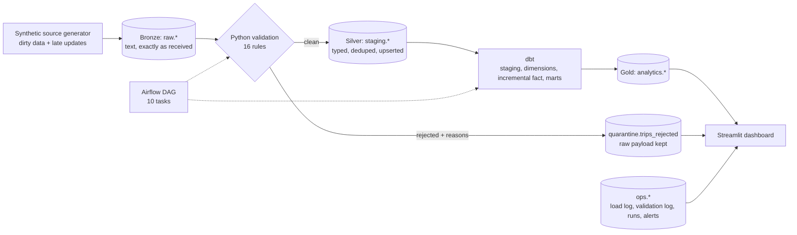
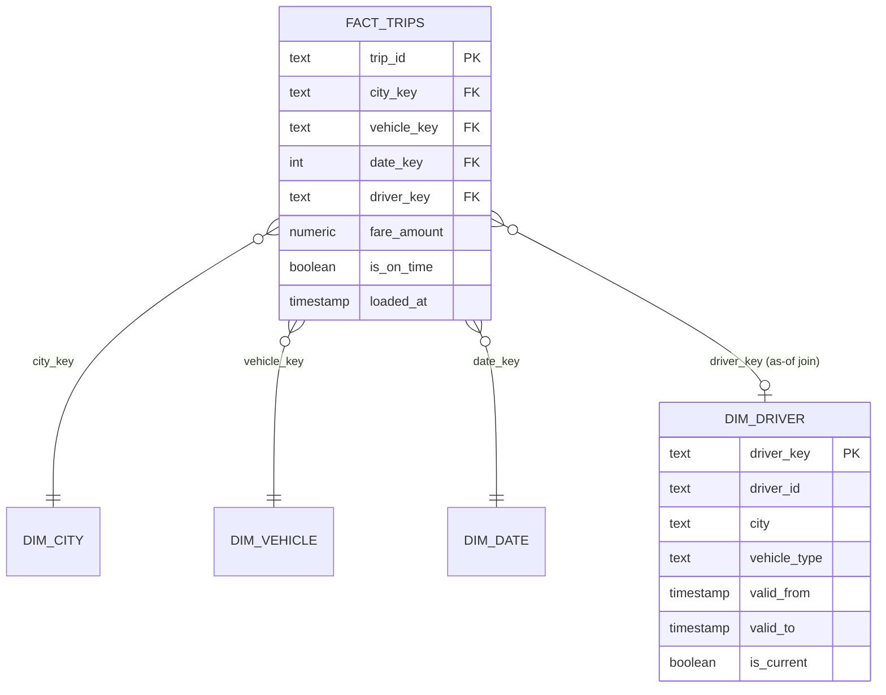
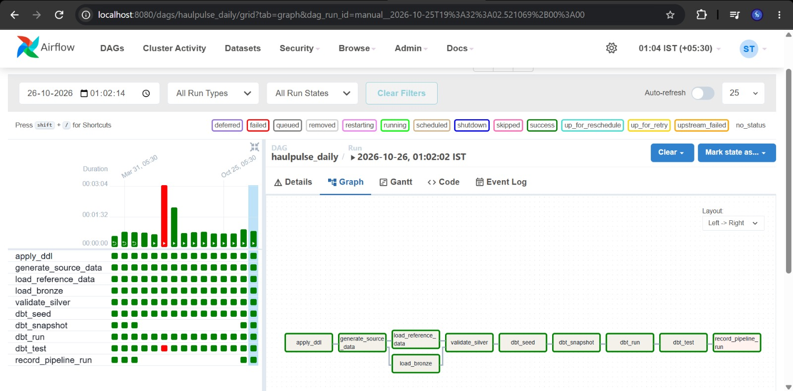
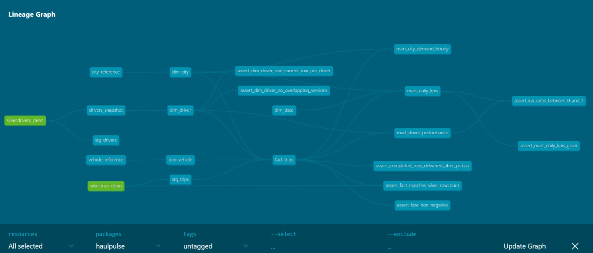
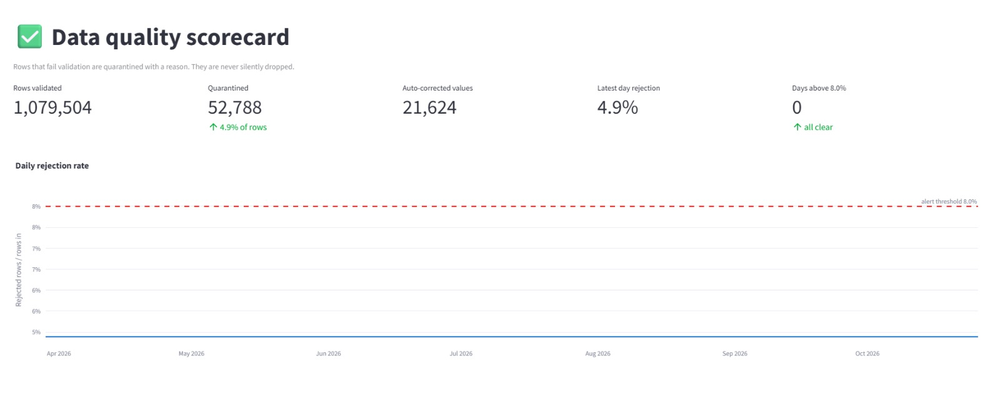
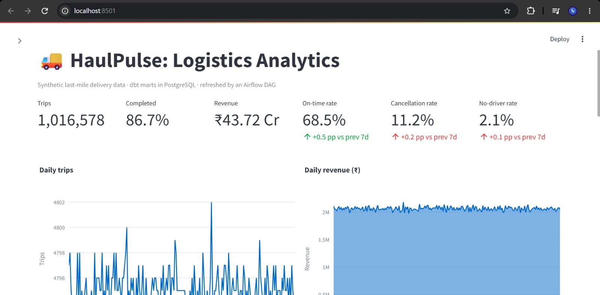
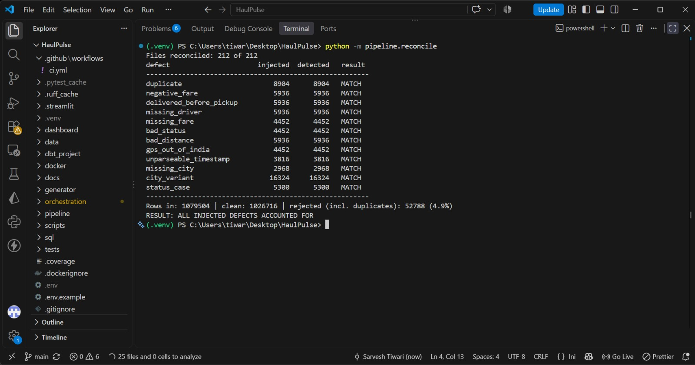
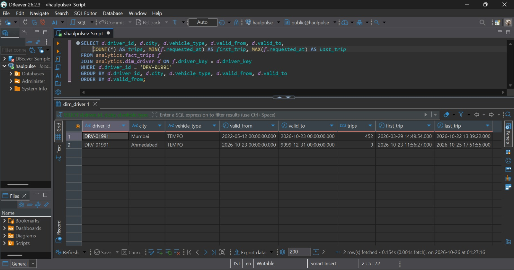

# HaulPulse: Logistics Data Engineering Pipeline


An end-to-end data engineering project modelled on last-mile logistics (the kind of delivery data a platform like Porter produces). It ingests messy daily trip files, validates and quarantines bad records, models a star schema with dbt, orchestrates everything with Airflow, and serves KPIs and a data-quality scorecard in Streamlit. Everything runs locally and for free (Docker, PostgreSQL, Python), with no GPU and no cloud bill.

> **All data is synthetic.** A seeded generator produces ~5,000 trips per day with deliberately injected defects, so every claim below can be checked against a known ground truth.

## Results at a glance

| Metric | Result |
|---|---|
| Scale tested | 1,064,228 trips across 209 daily files |
| End-to-end time (ingest, validate, model, test) | **207 s (~3.5 min)** on a laptop |
| Bronze load (PostgreSQL `COPY`) | ~30,800 rows/sec |
| Silver validation + upsert | ~8,100 rows/sec (the bottleneck, 63% of runtime) |
| Data quality | 52,041 rows quarantined (4.9%) + 21,318 values auto-corrected; **12 of 12 injected defect types reconciled exactly** |
| Query speed (1M-row fact table) | Selective query 54.6 ms to 3.6 ms (**15x**) with a composite index; lookup by trip id 63.7 ms to 0.02 ms |
| Tests | 55 pytest tests (98% coverage of the validation module), dbt tests (generic + 7 custom SQL tests), `N` dbt tests passing |
| CI | GitHub Actions runs lint, unit tests, then the full pipeline against a fresh PostgreSQL |
| One daily DAG run | 33 to 52 seconds (5,092 rows) |

## Architecture



| Layer | Schema | What happens |
|---|---|---|
| Bronze | `raw` | CSV loaded with `COPY`, all columns TEXT, per-file idempotent reload, row-count reconciliation, header contract check |
| Silver | `staging`, `quarantine` | Cleaning (city spellings, status casing), 16 validation rules, de-duplication, upsert with a newest-wins guard, rejects kept with reasons and original values |
| Gold | `analytics` | dbt star schema, SCD Type 2 driver dimension, incremental fact, 3 KPI marts |
| Ops | `ops` | Load log, validation log, per-run audit table, failure alerts |

### Data model



Marts: `mart_daily_kpis` (date x city), `mart_driver_performance` (one row per driver, with city rank and utilization), `mart_city_demand_hourly` (city x hour, with peak-hour flags).

## Key design decisions

- **Quarantine, never silently drop.** Every rejected row keeps all failing reasons and its original raw values as JSON, so an analyst can see exactly what the source sent.
- **Context-aware rules.** A missing driver is only a defect when the trip is not `NO_DRIVER_FOUND`. Fixable problems (city spellings, status casing) are corrected and counted, not rejected.
- **Idempotent everywhere.** Re-running any file or any day never duplicates data, which makes Airflow retries safe.
- **Late-arriving data.** Corrections for yesterday's trips arrive in today's file. Silver keeps the newest version by `updated_at`, and the incremental fact uses an **ingestion-time watermark (`loaded_at`)** rather than event time, so out-of-order backfills are never skipped.
- **SCD Type 2 with business-time validity.** dbt snapshots use a source `updated_at`, and the fact table joins the driver version valid at the trip's request time.
- **Airflow only schedules.** Tasks run the pipeline in an isolated virtualenv inside the image, because Airflow 2.x pins SQLAlchemy 1.4 while the pipeline needs 2.x.
- **Indexes in production, partitioning benchmarked.** At 1M rows, indexes gave the biggest wins; monthly partitioning cut blocks read by 85% for month-range queries but slowed lookups by a non-partition key. Partitioning is documented as the recommendation at roughly 10x this volume.

## Data quality

The generator injects 12 defect types (duplicates, negative fares, delivery before pickup, missing drivers or fares, bad statuses, impossible distances, GPS outside India, unparseable timestamps, missing city, city spelling variants, status casing) and writes a manifest of exactly what it injected. `python -m pipeline.reconcile` compares detections against that manifest: **all 12 match**, at 1M rows and in CI. The Data Quality page of the dashboard shows rejection trends, reasons, rule coverage, and a quarantine explorer.

## Query performance (1,016,628 rows, `EXPLAIN ANALYZE`, median of 7)

| Query | No index | + B-tree indexes | Monthly partitions only |
|---|---:|---:|---:|
| City revenue, 1 week | 54.57 ms | **3.56 ms (15x)** | 13.86 ms |
| All cities, 1 month | 65.89 ms | 48.61 ms | 36.44 ms |
| Single trip lookup | 63.68 ms | **0.02 ms** | 71.10 ms |

Details and plans in [`docs/benchmarks.md`](docs/benchmarks.md); throughput notes in [`docs/performance.md`](docs/performance.md).

## Testing and CI

- `pytest`: 55 tests, including a contract test (whatever the generator calls clean must pass the validator) and a unit-level reconciliation (every injected defect must be detected).
- dbt: unique, not_null, accepted_values, relationships, and 7 custom SQL tests (row-count match across layers, SCD2 version integrity, KPI ranges, grain checks).
- GitHub Actions: lint (`ruff`), unit tests, then a full end-to-end run on a PostgreSQL service container (generate, load, validate, reconcile, dbt seed/snapshot/run/test).

## Quick start (Windows, PowerShell)

Prerequisites: Python 3.11, Docker Desktop, Git.

```powershell
git clone https://github.com/sarveshh31/haulpulse.git
cd haulpulse
py -3.11 -m venv .venv
.venv\Scripts\Activate.ps1
pip install -r requirements.txt -r requirements-dashboard.txt

copy .env.example .env        # then edit .env: set POSTGRES_USER, POSTGRES_PASSWORD
docker compose up -d warehouse

python -m pipeline.bootstrap
python -m generator.generate --start-date 2026-10-19 --days 7 --rows 5000
python -m pipeline.load_bronze
python -m pipeline.run_silver
python -m pipeline.reconcile

. .\scripts\env.ps1
cd dbt_project
dbt seed; dbt snapshot; dbt run; dbt test
cd ..

streamlit run dashboard/app.py     # http://localhost:8501
```

To run the orchestrated version: `docker compose up -d --build`, then open Airflow at http://localhost:8080 (local-only login `admin` / `admin`) and trigger `haulpulse_daily`.

## Repository layout

```
generator/      synthetic source data, dirty-data injection, driver changes (SCD2 input)
pipeline/       bootstrap, bronze loader, validation rules, silver step, reconcile, benchmark
dbt_project/    staging views, dimensions, incremental fact, marts, snapshot, seeds, tests
orchestration/  Airflow DAG (dags/haulpulse_daily.py)
dashboard/      Streamlit app (Overview, City Demand, Drivers, Data Quality, Pipeline Health)
sql/            init schemas and DDL
docker/         Airflow image (isolated pipeline virtualenv)
tests/          pytest suite
docs/           benchmarks, performance notes, screenshots
.github/        CI workflow
```

## Limitations (honest notes)

- Data is synthetic. Daily volume is constant by design, and all cities share the same speed and ETA model, so city-level on-time differences are noise, not insight.
- Silver validation is the slowest stage (per-file Python processing). The next step would be batching files per transaction.
- dbt cannot natively partition PostgreSQL tables, so partitioning is benchmarked, not deployed.
- Runs on a single machine. At 100x volume I would move heavy transforms to a distributed engine (Spark) and ingest events through Kafka.

## Possible extensions

Kafka producer for live trip events, Great Expectations suite alongside the custom rules, email alerts via SMTP, and partitioned fact table once volume justifies it.

## Screenshots

| | |
|---|---|
|  |  |
|  |  |
|  |  |

## Author

Sarvesh Tiwari, Information Technology, RCOEM Nagpur · [GitHub](https://github.com/sarveshh31) · sarvesh.tiwari3108@gmail.com